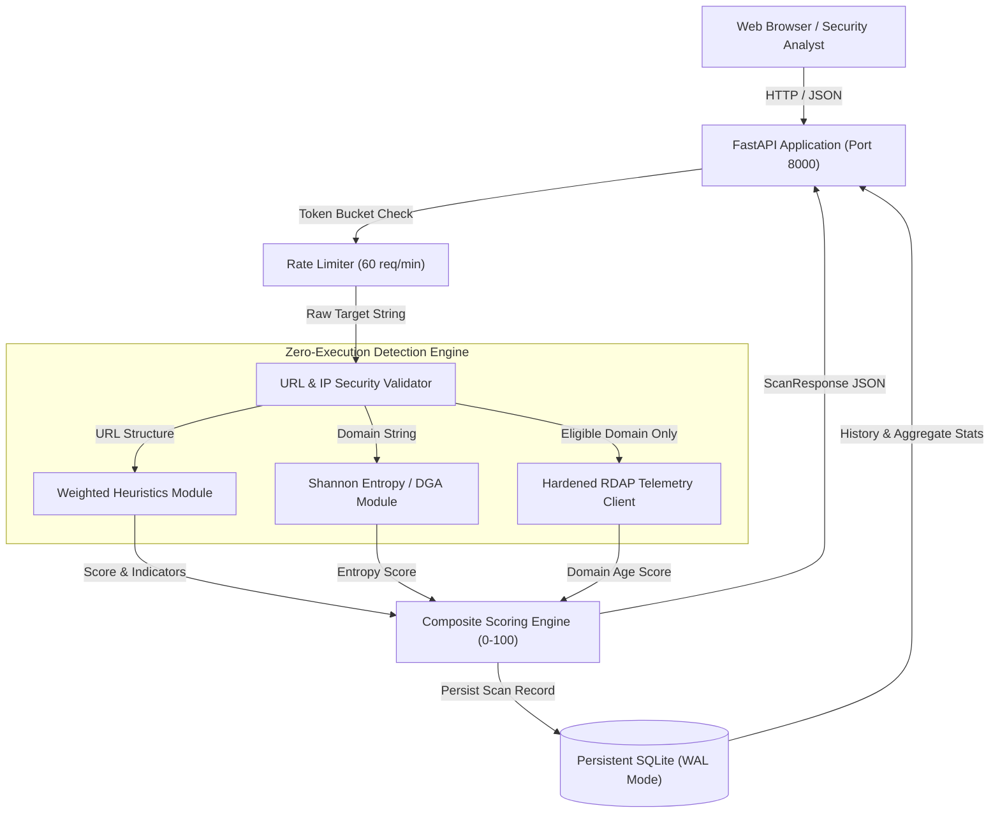

# Intelligent Phishing Detection Platform & URL Risk Analyser

[](https://github.com/your-username/url-risk-analyser/actions)
[](LICENSE)
[](https://www.python.org/)
[](https://fastapi.tiangolo.com/)

A lightweight, security-hardened threat intelligence platform and REST API for real-time URL risk assessment. The engine evaluates suspicious link structures, Shannon character entropy (DGA detection), typosquatting, and domain registration telemetry (RDAP) without directly crawling or executing untrusted payloads.

---

## 1. Problem Statement & Motivation

Phishing attacks and credential harvesting campaigns frequently deploy disposable domains, deceptive homoglyphs, and nested subdomains to deceive victims. Modern security workflows require rapid, zero-execution link analysis that flags malicious patterns without triggering server-side exploit payloads or introducing Server-Side Request Forgery (SSRF) vulnerabilities.

This project delivers an explainable, deterministic risk scoring engine paired with an operational cybersecurity dashboard and a production-grade FastAPI service.

---

## 2. Implemented Features

* **Real-Time Heuristic Scanner:** Analyzes missing HTTPS, raw IP destinations, link-local / cloud metadata ranges, deep subdomains, credential delimiters (`@`), and high-risk TLDs.
* **Typosquatting & Brand Defense:** Employs Levenshtein distance calculations against high-profile brands and flags compound threats combining brand names with phishing intent keywords (`login`, `verify`, `account`).
* **Shannon Character Entropy:** Calculates string randomness and digit concentration on domain labels to identify Domain Generation Algorithms (DGA).
* **Asynchronous Domain Telemetry:** Queries authoritative RDAP registries to evaluate domain age and flag newly registered infrastructure (< 30 days and < 90 days).
* **SSRF-Hardened Architecture:** Strictly avoids fetching submitted target URLs; validates hostnames and blocks redirects to private or internal subnets during external RDAP lookups.
* **Persistent Telemetry Storage:** Embedded SQLite database with Write-Ahead Logging (WAL) and tie-breaker indexing for rapid analytics and recent scan retrieval.
* **Rate-Limited API:** In-memory sliding-window rate limiting protecting public endpoints against denial of service.
* **Cybersecurity Dashboard:** Single-page responsive interface with dark glassmorphism styling, animated score gauges, telemetry cards, and DOM-escaped XSS defenses.

---

## 3. Architecture & Data Flow



---

## 4. Technology Stack

* **Backend:** Python 3.12+, FastAPI, Uvicorn, Pydantic v2
* **HTTP Client:** HTTPX (Asynchronous with strict timeouts and redirect inspections)
* **Storage:** SQLite 3 (WAL mode, indexed timestamps)
* **Frontend:** HTML5, Vanilla JavaScript, Tailwind CSS, JetBrains Mono
* **Testing:** Pytest, Pytest-Asyncio
* **Containerization:** Docker (Debian slim, non-root user execution)

---

## 5. Repository Structure

```text
.
├── .github/
│   └── workflows/
│       └── ci.yml               # Automated GitHub Actions test pipeline
├── app/
│   ├── routes/
│   │   └── scan.py              # API route definitions (/scan, /recent, /stats)
│   ├── limiter.py               # In-memory sliding-window IP rate limiter
│   └── main.py                  # FastAPI application entry point & CORS
├── config/
│   └── settings.py              # Centralized environment variable settings
├── database/
│   ├── db.py                    # SQLite connection & WAL mode initialization
│   ├── models.py                # Pydantic schemas and response contracts
│   └── queries.py               # Optimized database queries and statistics
├── engine/
│   ├── aggregator.py            # Central scanning orchestrator
│   ├── entropy.py               # Shannon entropy & digit analysis
│   ├── heuristics.py            # Weighted heuristic rules & typosquatting
│   ├── rdap.py                  # RDAP event parsing and domain age logic
│   ├── scoring.py               # Composite score clamping & classification
│   └── validator.py             # URL sanitization, SSRF filters, and IP checks
├── frontend/
│   └── index.html               # Security dashboard single-page interface
├── services/
│   └── rdap_service.py          # Hardened asynchronous RDAP client
├── tests/
│   ├── conftest.py              # Pytest fixtures & isolated disposable database
│   ├── test_api.py              # API endpoint & rate limit tests
│   ├── test_database.py         # Persistence & concurrency tests
│   ├── test_entropy.py          # Entropy edge cases & DGA tests
│   ├── test_heuristics.py       # Heuristic rules & typosquatting tests
│   ├── test_rdap.py             # Domain age & SSRF redirect rejection tests
│   ├── test_scoring.py          # Score clamping & boundary tests
│   └── test_validation.py       # URL validation, schemes, & private IP tests
├── docs/
│   ├── architecture.md          # In-depth architectural documentation
│   ├── deployment.md            # Production deployment guide
│   └── security.md              # Security analysis & threat model
├── .dockerignore                # Container build exclusion patterns
├── .env.example                 # Configuration template with placeholders
├── .gitignore                   # Git exclusion rules
├── CONTRIBUTING.md              # Contribution standards and local setup
├── Dockerfile                   # Non-root production container specification
├── docker-compose.yml           # Compose specification with persistent volumes
├── LICENSE                      # MIT Open Source License
├── requirements.txt             # Production dependencies
├── requirements-dev.txt         # Testing and development dependencies
└── SECURITY.md                  # Security policy and disclosure process
```

---

## 6. Prerequisites

* **Python:** 3.12 or newer
* **Operating System:** Windows 10/11, Linux, or macOS
* **Git:** Installed and available on your system path
* **Docker:** (Optional) for containerized deployments

---

## 7. Local Installation & Execution (Windows)

### Step 1: Clone Repository & Create Virtual Environment

```powershell
# Navigate to project directory
cd "Url Risk Analyser Project"

# Create virtual environment
python -m venv .venv

# Activate virtual environment
.\.venv\Scripts\Activate.ps1
```

### Step 2: Install Dependencies

```powershell
# Install production & testing dependencies
python -m pip install --upgrade pip
pip install -r requirements.txt
pip install -r requirements-dev.txt
```

### Step 3: Run the Application

```powershell
uvicorn app.main:app --reload --host 127.0.0.1 --port 8000
```
Visit **http://127.0.0.1:8000/** in your browser to view the interactive dashboard. Interactive Swagger API documentation is available at **http://127.0.0.1:8000/docs**.

---

## 8. Configuration (`.env.example`)

Copy the configuration template:
```powershell
copy .env.example .env
```

| Variable | Default Value | Description |
| :--- | :--- | :--- |
| `ENV` | `production` | Environment mode (`development`, `production`, `testing`). |
| `HOST` | `0.0.0.0` | Bind IP address for Uvicorn. |
| `PORT` | `8000` | Server listening port. |
| `DATABASE_PATH` | `phishing_platform.db` | Filepath for the SQLite database. |
| `RDAP_BASE_URL` | `https://rdap.org/domain/` | Upstream RDAP service endpoint. |
| `RDAP_TIMEOUT_SECONDS`| `4.0` | Egress timeout for RDAP network lookups. |
| `ALLOWED_ORIGINS` | `*` | Comma-separated list of permitted CORS origins. |
| `RATE_LIMIT_ENABLED`| `true` | Toggles in-memory client rate limiting. |
| `RATE_LIMIT_PER_MINUTE` | `60` | Maximum scan requests allowed per client IP/minute. |
| `MAX_URL_LENGTH` | `2048` | Maximum accepted character length for input URLs. |

---

## 9. API Reference & Contracts

### Analyze URL Risk
`POST /api/scan`

**Request Payload:**
```json
{
  "url": "https://secure-login-paypal.xyz"
}
```

**Response (`200 OK`):**
```json
{
  "score": 100,
  "level": "High Risk",
  "reasons": [
    "High-risk Top-Level Domain (TLD) detected on secure-login-paypal.xyz",
    "Multiple phishing keywords detected: login, secure",
    "Brand impersonation detected: targets brand 'paypal' outside official domain",
    "High Severity Compound Vector: Brand impersonation combined with phishing keywords",
    "Domain not found in RDAP registry (unregistered or newly created)"
  ],
  "intelligence": {
    "available": false,
    "registrar": "Domain not found in RDAP registry",
    "age": "N/A",
    "created": null,
    "expires": null
  }
}
```

### Retrieve Recent Scans
`GET /api/recent?limit=5`

**Response (`200 OK`):**
```json
[
  {
    "id": 59,
    "url": "https://secure-login-paypal5.xyz/",
    "score": 100,
    "classification": "High Risk",
    "timestamp": "2026-07-07 10:35:19",
    "creation_date": "N/A",
    "expiration_date": "N/A",
    "registrar": "N/A"
  }
]
```

### Retrieve Global Statistics
`GET /api/stats`

**Response (`200 OK`):**
```json
{
  "total_scans": 59,
  "phishing_count": 42,
  "suspicious_count": 12,
  "safe_count": 5
}
```

### Health Check Probe
`GET /health`

**Response (`200 OK`):**
```json
{
  "status": "healthy",
  "version": "1.0.0",
  "environment": "production"
}
```

---

## 10. Automated Testing

The automated test suite runs in an isolated testing environment that automatically creates a disposable temporary database, ensuring existing historical scan records are never overwritten or altered.

```powershell
# Run the complete test suite
pytest -v

# Run with concise summary
pytest -v --tb=short
```

**Verification Results:**
* **38 passed tests** covering URL validation, IP filtering, heuristic weights, entropy calculations, domain age scoring, database persistence, API rate limits, and health checks.

---

## 11. Docker & Containerized Deployment

### Local Container Build

```bash
# Build production Docker image
docker build -t url-risk-analyser:latest .

# Run container with persistent SQLite volume
docker run -d \
  --name url-risk-analyser \
  -p 8000:8000 \
  -v $(pwd)/data:/app/data \
  url-risk-analyser:latest
```

### Docker Compose

```bash
docker compose up -d
```
The compose setup automatically attaches a named volume (`phish_data`) to `/app/data`, guaranteeing scan history persists across container updates.

---

## 12. Deployment Guide (Fly.io / Render)

### Recommended Target: Fly.io
Fly.io provides low-latency execution and persistent volume support ideal for SQLite:

1. Install Fly CLI: `curl -L https://fly.io/install.sh | sh`
2. Create persistent volume: `fly volumes create phish_data --size 1`
3. Deploy container: `fly deploy`

*(Refer to [docs/deployment.md](docs/deployment.md) for full instructions covering Fly.io, Render, and self-hosted VPS setups).*

---

## 13. Security Considerations & Limitations

* **No Direct Crawling:** The server never makes outbound HTTP/S requests to the user-supplied target URL. This architectural constraint eliminates remote code execution, server-side exploit delivery, and browser zero-day hazards.
* **SSRF Defense:** Only valid domain names trigger RDAP queries. Raw IP addresses, loopback addresses (`127.0.0.1`), link-local cloud metadata (`169.254.169.254`), and private subnets (`10.0.0.0/8`, `192.168.0.0/16`) are blocked from external lookup.
* **Probabilistic Scoring:** Scoring reflects heuristic anomalies and domain age metrics; a **Safe** rating does not guarantee legitimacy, nor does a **High Risk** rating constitute legal proof of malice.

---

## 14. License

This project is licensed under the terms of the [MIT License](LICENSE).
