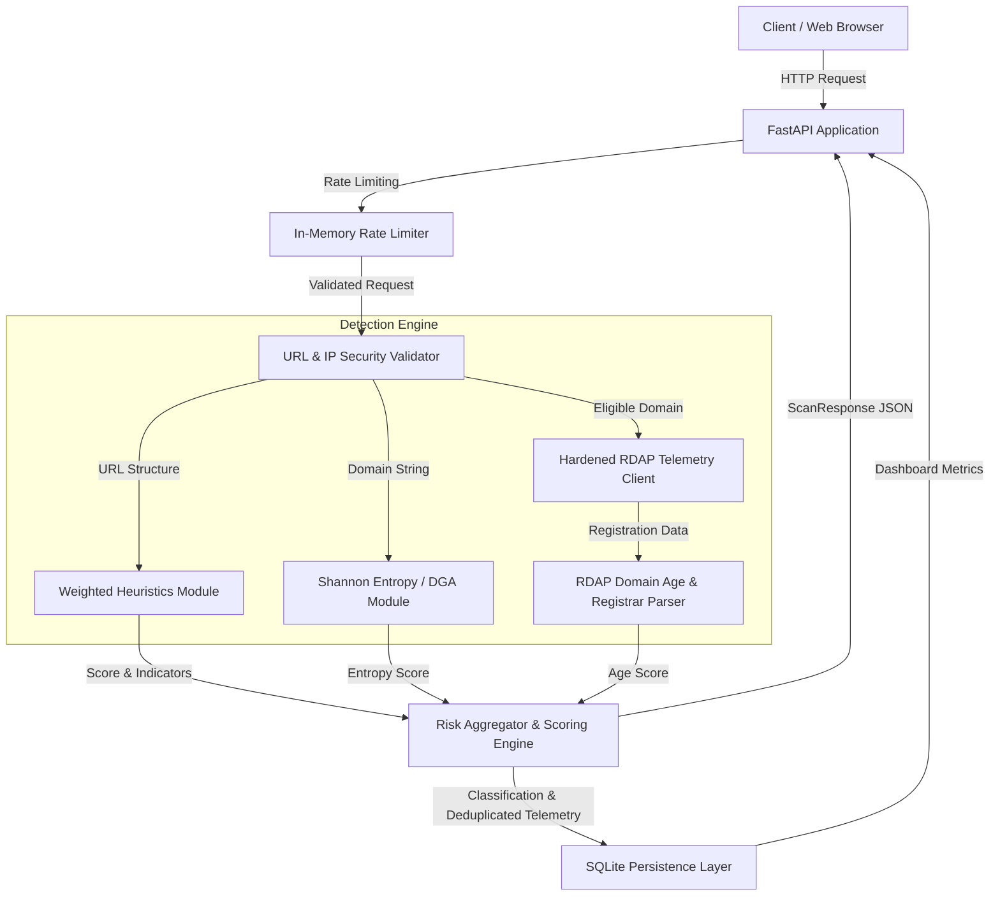

# Architecture & Detection Methodology

The **URL Risk Analyser / Phishing Detection Platform** analyzes target URLs without executing untrusted payloads or performing direct HTTP crawls on submitted links.

---

## High-Level Architecture Diagram



---

## Detection Modules & Scoring Weights

The composite risk score is clamped strictly between **0 and 100** and categorized into three operational threat bands:
- **0 – 20: Safe**
- **21 – 50: Suspicious**
- **51 – 100: High Risk**

### 1. Weighted Heuristics (`engine/heuristics.py`)
- **Missing HTTPS (+25):** Plain HTTP connection susceptible to interception or credential spoofing.
- **Direct IP Host (+40):** Destination uses an IPv4/IPv6 address instead of a domain name.
- **Private / Loopback IP (+40):** Destination points to an internal, link-local (cloud metadata), or loopback range.
- **Credential Delimiter `@` (+30):** Exploited in phishing to mask destination authority.
- **Excessive URL Length (+15):** Overall URL length > 75 characters.
- **Deep Subdomains (+25):** 3 or more subdomain levels preceding the registrable domain.
- **High-Risk TLD (+30):** Top-level domains frequently abused in spam/phishing campaigns (`.xyz`, `.top`, `.tk`, `.ru`, `.biz`, etc.).
- **Typosquatting (+40):** Levenshtein distance $\le 2$ compared to high-value trusted domains (e.g. `google.com`, `paypal.com`).
- **Phishing Intent Keywords (+15 to +30):** Presence of keywords such as `login`, `verify`, `banking`, `secure`, `wallet`.
- **Brand Impersonation (+40):** Known corporate brand names embedded in subdomains or path outside official domains.
- **Compound Threat Vector (Floor: 80):** High-severity correlation when brand impersonation coincides with phishing keywords.

### 2. Shannon Entropy & DGA Detection (`engine/entropy.py`)
- Evaluates character distribution entropy on the primary domain label:
  $$H(X) = -\sum_{i=1}^n P(x_i) \log_2 P(x_i)$$
- Domains with entropy $> 3.8$ and length $\ge 8$ characters or excessive digit concentrations ($\ge 4$ numeric digits) add risk points (+15 to +20).

### 3. Domain Intelligence (`engine/rdap.py` & `services/rdap_service.py`)
- Asynchronous querying of registry records via `rdap.org`.
- **Critically Young Domain (< 30 days) (+35):** Highest correlation with newly minted disposable phishing infrastructure.
- **Newly Registered Domain (< 90 days) (+25):** Young domains undergoing initial reputation accumulation.
- **Missing Registry Records / 404 (+15):** Domain not present in authoritative registries.

---

## Database Architecture (`database/db.py`)

Persistent storage utilizes SQLite configured with Write-Ahead Logging (WAL) mode for concurrency:

```sql
CREATE TABLE IF NOT EXISTS scans (
    id INTEGER PRIMARY KEY AUTOINCREMENT,
    url TEXT NOT NULL,
    score INTEGER NOT NULL,
    classification TEXT NOT NULL,
    timestamp DATETIME DEFAULT CURRENT_TIMESTAMP,
    creation_date TEXT,
    expiration_date TEXT,
    registrar TEXT
);

CREATE INDEX IF NOT EXISTS idx_scans_timestamp ON scans (timestamp DESC);
CREATE INDEX IF NOT EXISTS idx_scans_classification ON scans (classification);
```
